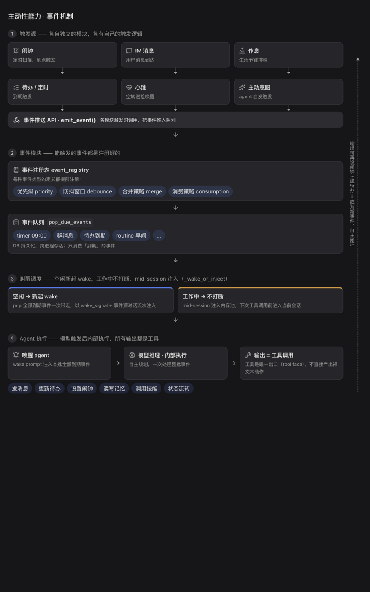
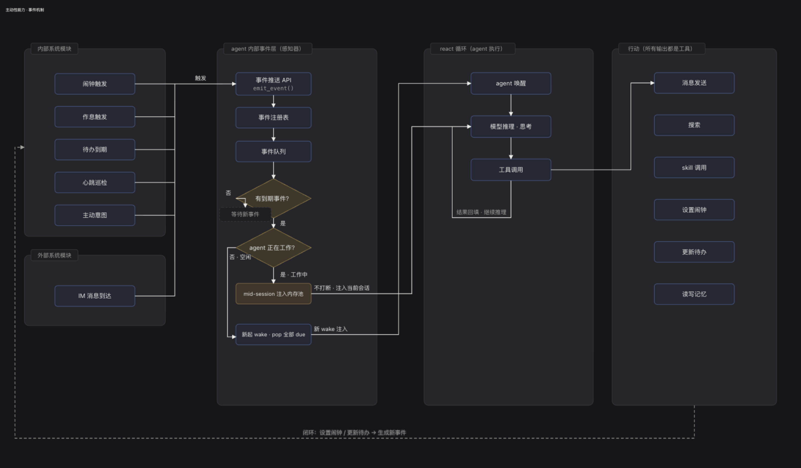

# Digital Life

**具备主动性的 7×24 数字生命** —— 它有作息、有精力、有记忆；没人找它时自己过日子，被叫到时秒回你。

速度与能力，业界通常二选一：语音助手秒回但干不了活，Agent 框架能干活却转半天。Digital Life 两个都要——

- **回复速度和某包一致**：全双工语音，打断、抢话抑制、回声消除，像和真人说话
- **实干能力对齐 Coding Agent**：拆任务、管待办、调工具、跑技能，跨唤醒持续推进

再加一套主动性事件系统（作息 + 精力 + 自驱意图全部归一为事件：空闲时唤醒思考，工作中不打断、改为注入，做完事自动收尾）——Agent 因此「活着」，而不是一问一答。

## 核心特性

- **主动性**：作息 + 精力 + 自驱事件驱动。没人布置任务，TA 也会自己醒来推进目标——主动性是事件系统唤醒的，不是被人 @ 出来的
- **语音全双工**：回声消除、打断检测、抢话抑制、声纹分人——像和真人说话，该打断就打断
- **持续记忆**：聊过的事都记得，长期记忆越用越牢
- **多通道同体**：微信、飞书、群聊、私聊、语音、网页——都是同一个 TA，没有分身
- **本地优先**：引擎、数据、记忆全在本机；模型 BYOK 自带 Key
- **Mac 一体化**：一个 DMG 装完即活，出生即有出厂性格

## 框架

事件总线是一等公民：所有入口（IM 消息、语音、闹钟、待办、作息、主动意图）经 `emit_event()` 推进队列，事件注册表决定优先级/防抖/合并/消费策略；唤醒调度按「空闲 → 起一次 wake，工作中 → 不打断、mid-session 注入」仲裁；Agent 醒来后所有输出都是工具调用——发消息、更新待办、设闹钟、读写记忆，构成「输出可再设闹钟 → 建待办 → 成为新事件」的自主闭环。

完整技术全景（唤醒决策分支 / mid-session 注入 / 自主闭环）

## 理论思考

这个项目的底层不是工程直觉，而是先想清楚了「数字生命」是什么：

- **[从「问答」到「共存」：role_user 在 Agent 时代还合理吗？](docs/theory/ontology-from-qa-to-coexistence-role-user-in-the-agent-era.pdf)** —— 为什么「用户/助手」的角色框架撑不起一个持续存在的生命体
- **[自主与连续：数字生命的本体论地基](docs/theory/autonomy-and-continuity-the-ontological-ground-of-digital-life.pdf)** —— 自主性与连续性，如何成为一个数字生命的地基

感兴趣再读，不读不影响使用。

## 下载

**macOS 14+（Apple Silicon）**：前往 [Releases](https://github.com/InquisiMind/digital-life-app/releases/latest) 下载 DMG，安装即用。

首次使用：创建实例只需名字、唤醒词、人设三样；模型 Key 在系统设置里配（任意 OpenAI 兼容接口）。

## 许可

[PolyForm Noncommercial](LICENSE.md)：**个人 / 非商业用途免费**使用、修改、分发；**商业用途需事先取得书面授权**。
